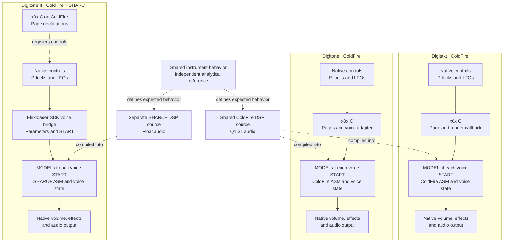

# Architecture: one mod, three devices, two DSP targets

Each device installs one **X0X KICKS** mod with a saved MODEL control. The
models share a musical specification, while each CPU has its own assembly
implementation. Digitakt and Digitone reuse the same ColdFire DSP source;
Digitone II uses SHARC+ DSP source.

Solid arrows show the running audio/control path. Dashed arrows show shared
source, registration or design relationships.

C handles each device's native pages and integration. On DT and DN, the C
render path calls ColdFire assembly. On DN2, the native SDK bridge calls SHARC+
assembly directly; the C selector helper in `machines/digitone2/controls.c`
is an executable host reference for tests and is not part of that installed
render path.

MODEL is stored per sound/track and takes effect for a voice on its next START.
Each voice owns its state. Switching its model clears its previous model's
state, while other tracks can keep their own selection. There is one machine
registration per device, so using 808 and 909 on different tracks does not
require another firmware installation.

The approved controls are A **TNTUN=64**, B **DECAY=64**, C **ATTK=64** and
F **MODEL=0**, with the other positions blank. Native track level controls
volume. MODEL below 64 selects 808; 64 and above selects 909.

The first audible increment is an uncalibrated 808 body: a 55 Hz damped sine
with a fixed pitch and live DECAY feedback control. The provisional range is
approximately 142 ms to 1 second, with 250 ms at the approved default. A
[1 ms rectangular drive](808-excitation.md) now excites the provisional mode
instead of setting an instantaneous amplitude. TNTUN
now controls the [808 passive Tone RC stage](808-tone.md); its resistance mapping
is provisional pending stock-pot calibration. Live Tone/Decay edits keep the
ringing state; START currently restarts the body and clears the Tone history.
The [C47 coupling stage](808-coupling.md) follows Tone with fixed internal level;
native track level still controls volume. ATTK is ignored for 808.
The [first 909 body](909-body.md) adds an unshaped
triangle oscillator with provisional fixed pitch and live unloaded C8 RC Decay. Its full stock
Tune/Decay/Attack behavior and diode shaping follow incrementally. Circuit
excitation, stock 808 feedback/Decay mapping, the loaded output network and faithful
retrigger behavior remain engine work.

The shared model defines the intended musical behavior. It does not translate
one CPU's assembly into the other, and the audio renderer is not portable C.
Both CPU implementations are checked against that independent reference, so
either implementation can change without redefining the instrument.

The device-specific C files live under [`machines/`](../machines/); shared
ColdFire audio code is under [`targets/coldfire/`](../targets/coldfire/), and
SHARC+ audio code is under [`targets/sharc/`](../targets/sharc/). Each device
gets its own firmware build containing the one combined mod. Remaining engine
work is tracked in [#9](https://github.com/simonjohansson/x0x/issues/9) and
[#25](https://github.com/simonjohansson/x0x/issues/25).
